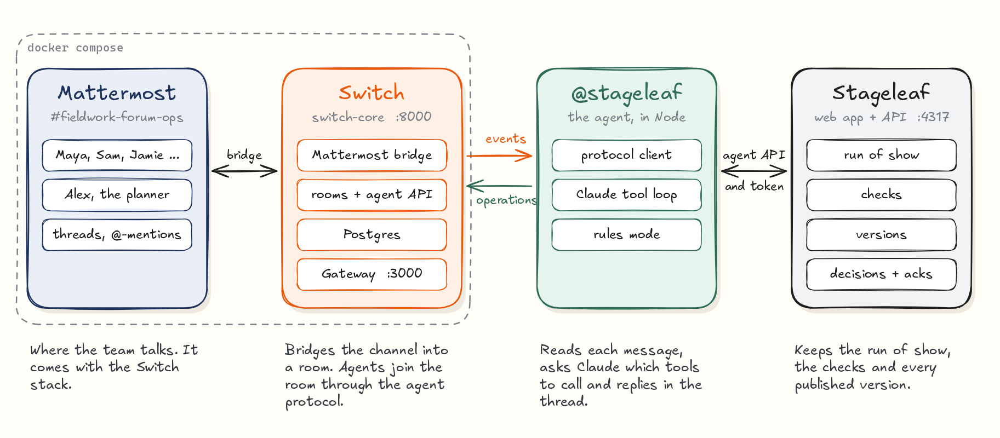

# Stageleaf

**When one thing changes at an event, everyone ends up on the same run of show.**

Stageleaf is an event-operations workspace with an AI agent that works in the event team's chat room through [Switch](https://github.com/sandbox-quantum/switch). Someone reports a change in the room. The agent checks it against the live plan, proposes a revision that passes Stageleaf's deterministic checks, and asks the affected people by name. They decide in the thread, the lead planner publishes, and each person acknowledges their own updated brief.

Built for the [Flip the Switch hackathon](https://www.wemakedevs.org/hackathons/switch), November 4–7, 2026: Best Business Workflow track.

> **Blog post:** [Building an event-day agent on Switch](https://tpavankalyan.github.io/stageleaf/) ([Excalidraw edition](docs/stageleaf-blog.excalidraw), [PDF](docs/stageleaf-blog.pdf)) · **Demo video:** [2 min 24 s](https://tpavankalyan.github.io/stageleaf/stageleaf-demo.mp4) · **Recorded with:** Switch 0.31.0, Mattermost 11.9, Claude Opus 5.5 on Amazon Bedrock



## The workflow in one thread

The keynote speaker's flight is late. This is the exchange from the recorded demo run, lightly trimmed. Claude Opus 5.5 does the reasoning, and every action goes through Stageleaf.

> **@maya:** @stageleaf Heads up: my flight into SFO is running late. I won't get to the venue until about 11:45, so I can't do the 11:15 keynote slot.
>
> **@stageleaf:** I've updated your arrival to 11:45. My proposal is to swap your keynote with the builders' panel. Lunch and the other fixed sessions don't move.
> - **Opening keynote — Maya Ellis**: 11:15–12:00 → 14:30–15:15
> - **The builders' panel**: 14:30–15:15 → 11:15–12:00
>
> I also checked keeping the keynote right after lunch at 13:00. That pushes **Breakdown** to 17:30, but Sam's crew leaves at 17:00. @jamie, can the four panelists do 11:15? Stageleaf doesn't have their times. @maya @sam @jamie please reply "approve" or "decline" with a reason in this thread.
>
> **@sam:** Approve. AV is fine with the swap, the mic setup is the same for both sessions.
>
> **@robin:** Approve from me too, registration is all set 👍
>
> **@stageleaf:** Thanks, @robin. This change doesn't need your decision, because **Doors & registration** stays at 10:30–11:00. The people who need to decide are @maya and @jamie.
>
> **@jamie:** Approved. I checked with the panelists and all four are already here and can do 11:15. · **@maya:** Approve, thank you! 14:30 works for me.
>
> **@stageleaf:** I've recorded your approval, @maya. @sam and @jamie have also approved, so this change has every decision it needs. @alex, should I publish this as the new version?
>
> **@alex:** Looks good. Publish it.
>
> **@stageleaf** (top level): Version 2 of the Fieldwork Forum run of show is published. The keynote and the builders' panel have swapped. **(In the thread):** Please check your changes and reply "ack": @maya: **Opening keynote** → 14:30–15:15 · @jamie: **The builders' panel** → 11:15–12:00 · @sam: both.
>
> **@sam:** ack, mic plan updated · **@jamie:** Got it 👍 · **@maya:** ack → **@stageleaf:** @sam, @jamie and you have all acknowledged version 2, and nobody is left to reply.

What the agent did, and what Stageleaf checked, at each step:

| In the room | What happened |
| --- | --- |
| Maya reports her delay | The agent recorded Maya's new arrival (11:45). Stageleaf then flagged the keynote as outside her availability. |
| The agent proposes | The agent tested options with `preview_change`. Moving the keynote after lunch pushes breakdown past Sam's recorded 17:00 departure, and Stageleaf rejects that. The swap passes, so the agent proposed it. Stageleaf named the decision owners: Maya, Sam and Jamie. |
| Owners reply in the thread | Each approval is recorded against the person's own chat account. Robin, who isn't an affected owner, cannot approve. |
| Alex says "publish" | Only the lead planner's handle can publish. Stageleaf applied the approved change, published v2, and the agent updated the room's `run-of-show` document. |
| People acknowledge | Each acknowledgment is recorded against v2. Only people whose assignments changed are asked. |

In Stageleaf, the planner sees the same record: who reported the change, who decided and in which room, and who has acknowledged v2.

## Why Switch is central

Without Switch, the workflow doesn't exist. The team's conversation is where changes are reported and decisions are made. Switch puts the agent in that conversation and tells it reliably who said what.

| Switch capability | How Stageleaf uses it |
| --- | --- |
| [Agent protocol](https://docs.switchagents.ai/switch-rooms/internals/agent-protocol) (SSE down, HTTP up) | `agent/switch-client.mjs` implements it directly: the event stream, fenced heartbeats (the `generation` echo the server requires), reconnects with `Last-Event-ID`, and operations. |
| Rooms bridged to Mattermost | The event room is a Mattermost channel that Switch provisioned with `create_room`. The agent has its own bot account in it. |
| Room instructions (shared context) | The room tells every agent and person the conventions: one thread per change, only affected owners decide, only the lead planner publishes. |
| Room documents | After each publish, the agent writes the run of show to the room document `run-of-show`, so the published plan lives in the room's context. |
| Sender identity | Every message carries the sender's chat handle (e.g. `maya`). Stageleaf maps handles to contacts and accepts decisions and acknowledgments only from the right person. |
| Threads and *follow the conversation* | Replies in the agent's thread reach it without an @-mention. This is Switch's `follow_the_conversation` feature flag. |
| Addressing policy (Gateway) | The agent answers anyone in its rooms, not only its owner, because every team member reports and decides. Setup opens this through the Gateway admin API. |

## The agents in the room

- **`@stageleaf`** is a custom agent on the Switch agent protocol (`agent/`). It reasons with **Claude Opus 5.5**, via Amazon Bedrock or the Claude API, and acts only through tools that call Stageleaf's agent API (`server/agent-api.mjs`).
  - **Tools:** `get_event`, `record_availability`, `preview_change`, `propose_change`, `record_decision`, `withdraw_proposal`, `publish_revision`, `record_acknowledgment`, `post_announcement`, `link_room_to_event`.
- **Rules mode:** with no model credentials, the same agent understands explicit commands such as `swap … with …`, `approve`, `publish` and `ack`. The workflow is reproducible without an API key.
- **People:** the room is shared with the event team: Alex (lead planner), Jamie (program lead), Sam (venue and AV), Avery (catering), Robin (guest experience) and Maya (keynote speaker).

### Trust model

- **Identity comes from Switch, never from the model.** For each message, the agent's code builds `evidence` from the Switch event: room, message id, sender handle. Tool schemas have no "who" field, so the model cannot claim to act for anyone else. `test/agent.test.mjs` proves a scripted model can't record an approval for a person who didn't send the message.
- **Stageleaf verifies every action.** It checks that the room is the event's linked room and that the handle is the right contact for a decision or acknowledgment. Linking a room and publishing are restricted to the planner's handle.
- **Deterministic checks decide feasibility.** The model proposes; Stageleaf checks venue hours, fixed activities, room overlaps and recorded availability. The agent is told never to invent availability or flexibility.
- **Scoped, revocable access.** The agent uses an agent token that the planner issues and revokes in Stageleaf (Agent access). It is scoped to that planner's events. No capability links are posted in the room.

## Run it locally (about 10 minutes)

**Requirements:**

- Node 22.13 or later
- Docker with Compose v2
- For the model, one of:
  - AWS credentials with Bedrock access to Claude Opus 5.5;
  - an `ANTHROPIC_API_KEY`;
  - nothing, for rules mode.

```sh
git clone https://github.com/tpavankalyan/stageleaf && cd stageleaf
npm ci && npm run build

npm run switch:up     # Switch 0.31.0 + Mattermost + Gateway in Docker (secrets generated into switch/.env)
npm start             # Stageleaf on http://localhost:4317            (terminal 1)
npm run demo:setup    # agent, team accounts, room, sample event, v1 (terminal 2)
npm run agent         # the @stageleaf agent                           (terminal 3)
```

What each command does:

- `switch:up` downloads the official standalone Compose file for the pinned Switch release. It enables the `follow_the_conversation` feature flag, then starts switch-core, Postgres, Mattermost and the Gateway.
- `demo:setup` covers both systems:
  - **Switch side:** registers `@stageleaf` with the server's agent registration token, opens its addressing, creates the team's Mattermost accounts, and creates the event room with its instructions.
  - **Stageleaf side:** creates the lead planner's account and the labelled sample event, publishes v1, issues an agent token and links the room.
  - Credentials go to `switch/credentials.json` (mode 600, git-ignored).
- `agent` connects to Switch and to Stageleaf, then picks the model:
  - Bedrock when AWS credentials are present;
  - otherwise the Claude API if `ANTHROPIC_API_KEY` is set;
  - otherwise rules mode.

Then open Mattermost at **http://localhost:8065** and sign in as `alex`. All demo passwords are in `switch/credentials.json`. Open the room `fieldwork-forum-ops`, and Stageleaf at **http://localhost:4317** as `alex@fieldwork.example`.

**Play the scenario:**

- **Automatically:** `node scripts/rehearse.mjs` types each person's message and waits for the agent's real reply.
- **By hand:** post as any team member with `node scripts/say.mjs <user> "<message>" [--thread last]`, or sign in to Mattermost as them.
- **Start over:** `npm run demo:setup -- --fresh` creates a new sample event in a new room.

To use your own event instead, open Agent access in Stageleaf:

1. Set your chat handle and create an agent token.
2. Run the agent with `STAGELEAF_AGENT_TOKEN=…`.
3. In your Switch room, say `@stageleaf link this room to <event name>`.
4. Give each contact their chat handle in Team & vendors.

### Configuration

| Variable | Default | Purpose |
| --- | --- | --- |
| `STAGELEAF_LLM` | `auto` | `bedrock`, `bedrock-mantle`, `anthropic` or `rules`. `auto` prefers Bedrock, then the Claude API, then rules. |
| `STAGELEAF_MODEL` / `STAGELEAF_EFFORT` | `claude-opus-5-5` / `medium` | Model and effort. Bedrock uses the `global.anthropic.<model>` inference profile; override it with `STAGELEAF_BEDROCK_MODEL`. |
| `AWS_REGION` / `ANTHROPIC_API_KEY` | | Model credentials, read by the official SDKs. |
| `SWITCH_API_URL` | `http://127.0.0.1:8000` | Switch agent bridge |
| `SWITCH_AGENT_ID`, `SWITCH_AGENT_KEY` | from `switch/credentials.json` | The registered agent |
| `STAGELEAF_URL`, `STAGELEAF_AGENT_TOKEN` | from `switch/credentials.json` | Stageleaf and the planner-issued agent token |
| `PORT`, `HOST`, `STAGELEAF_DB`, `PUBLIC_ORIGIN`, `NODE_ENV` | `4317`, `0.0.0.0`, `data/stageleaf.sqlite` | The Stageleaf server |

## The Stageleaf app

Stageleaf is useful before anything goes wrong.

- **Plan:** create an event; build the run of show (or import CSV); record team and vendor commitments, availability and chat handles; assign tasks.
- **Publish:** publish versioned briefs. Each person gets a scoped brief link showing only their assignments.
- **Change:** propose timing changes, collect decisions from affected owners (by link or in chat), then publish a revision.
- **Protections:**
  - Edits are version-checked, and a stale proposal can't be applied.
  - Publishing is blocked while conflicts or open proposals remain.
  - Accounts are isolated server-side. Data persists in SQLite.

## Tests

```sh
npm test    # 11 tests: Stageleaf API, rendered UI, agent API, Switch client, agent workflow
```

- `test/agent-api.test.mjs`: the chat-driven flow end to end. Covers rejected rooms, owner-only decisions, planner-only publish, acknowledgments and token scoping.
- `test/agent.test.mjs`: the agent in rules mode against a real Stageleaf, plus the model-can't-impersonate check.
- `test/switch-client.test.mjs`: the protocol client against a fake bridge. Covers the generation echo on heartbeats, event delivery, and resuming after eviction.
- `test/api.test.mjs`, `test/ui.test.jsx`: the Stageleaf app.

## Project layout

```text
agent/            The Switch agent: protocol client, Claude tool loop, rules fallback
server/           Stageleaf API, agent API, domain rules and views
src/              The planner's web app (React)
scripts/          Switch setup, demo setup, rehearsal and `say` helpers
switch/           up.sh / down.sh for a local Switch server (secrets stay in switch/.env)
test/             Node test runner suites
docs/             The blog: web edition (index.html), Excalidraw canvas, PDF, figures, demo video
docs/src/         The blog's text and the generator that draws the canvas and the figures
```

## Limitations

- **Single-day events, one planner per workspace.** Other people take part through chat or brief links.
- **Mattermost is the tested chat app.** Switch also bridges Slack, Teams, Discord and Telegram. Stageleaf maps people by the username Switch reports, which may need adjusting per platform.
- **Thread replies need `follow_the_conversation`.** Without the flag, people mention `@stageleaf` in each reply.
- **The agent handles one message at a time.** It relies on Switch's buffer to catch up after a restart.
- **Deterministic checks only see recorded data.** Availability, costs or contracts that aren't recorded are unknown, and the agent says so rather than guessing.
- **No email or SMS delivery.** Briefs are shared by link or acknowledged in chat.

## Built during the hackathon

The Stageleaf app, the agent, the agent API, the Switch setup and the room workflow were all built between November 4 and 7, 2026. Switch itself is not vendored: `switch/up.sh` downloads the official Compose file for the pinned release. Switch is © SandboxAQ, licensed Apache 2.0 with the Commons Clause.

## License

MIT. See [LICENSE](LICENSE).
