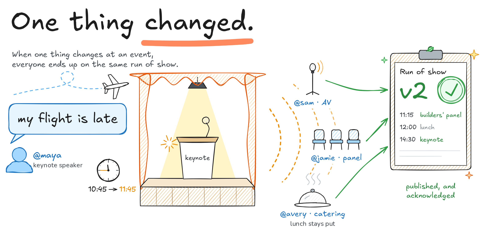
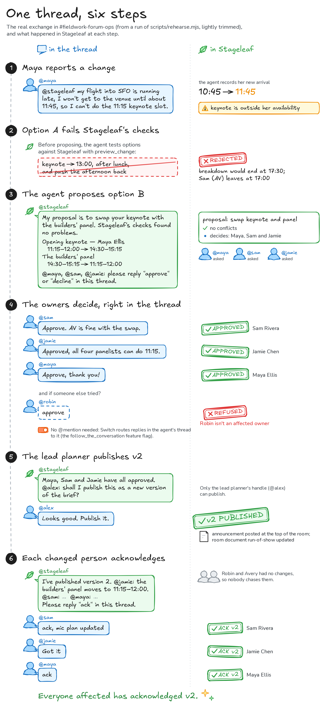
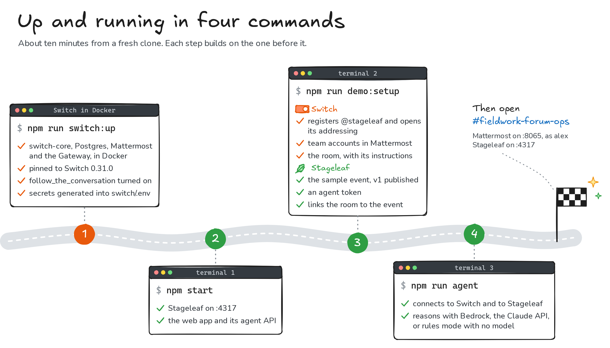
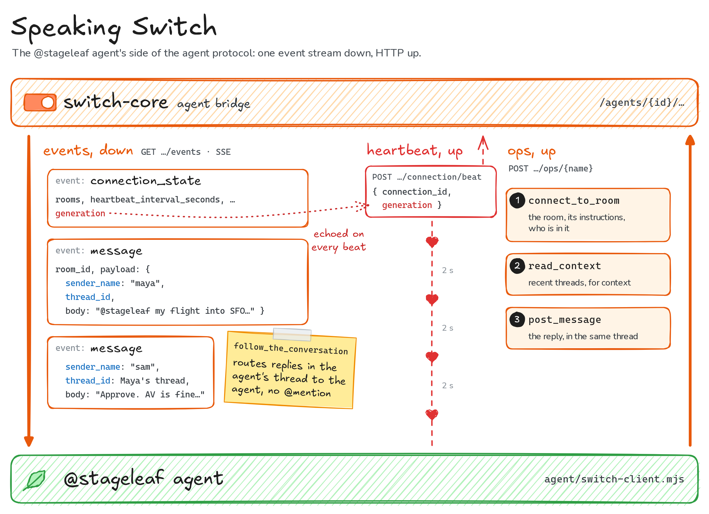
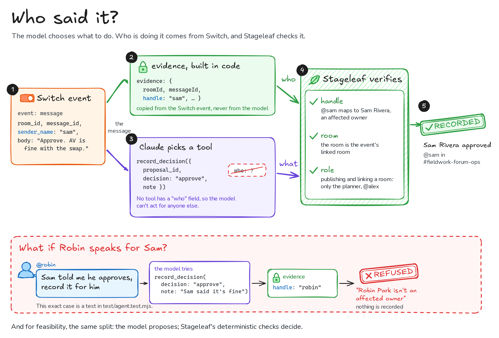
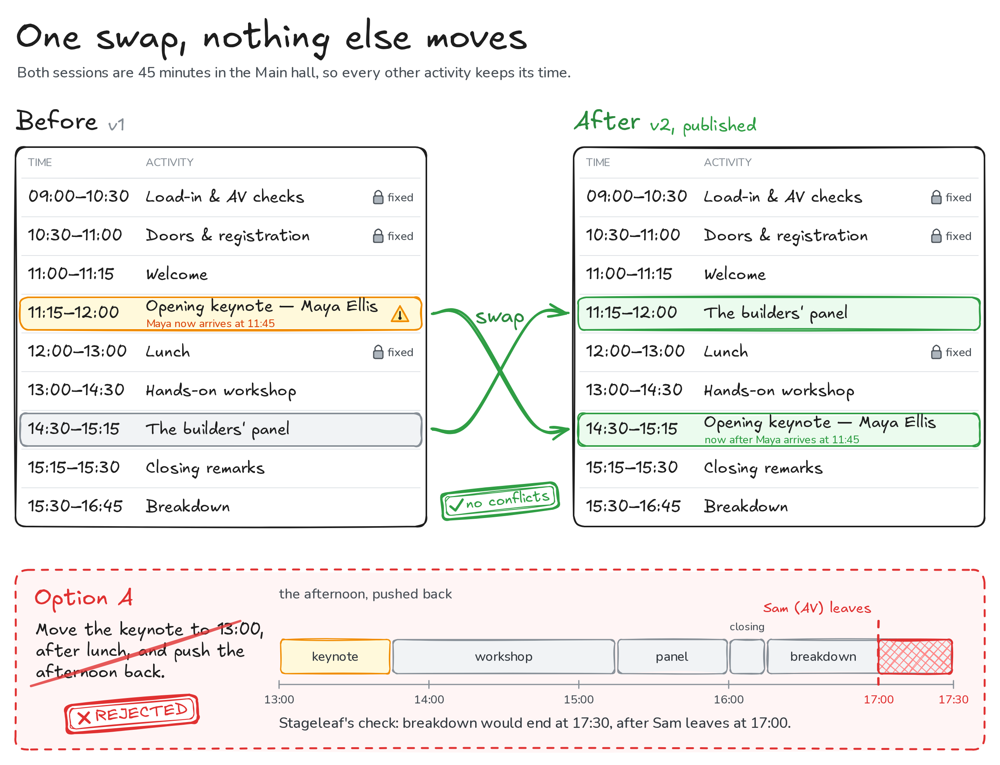
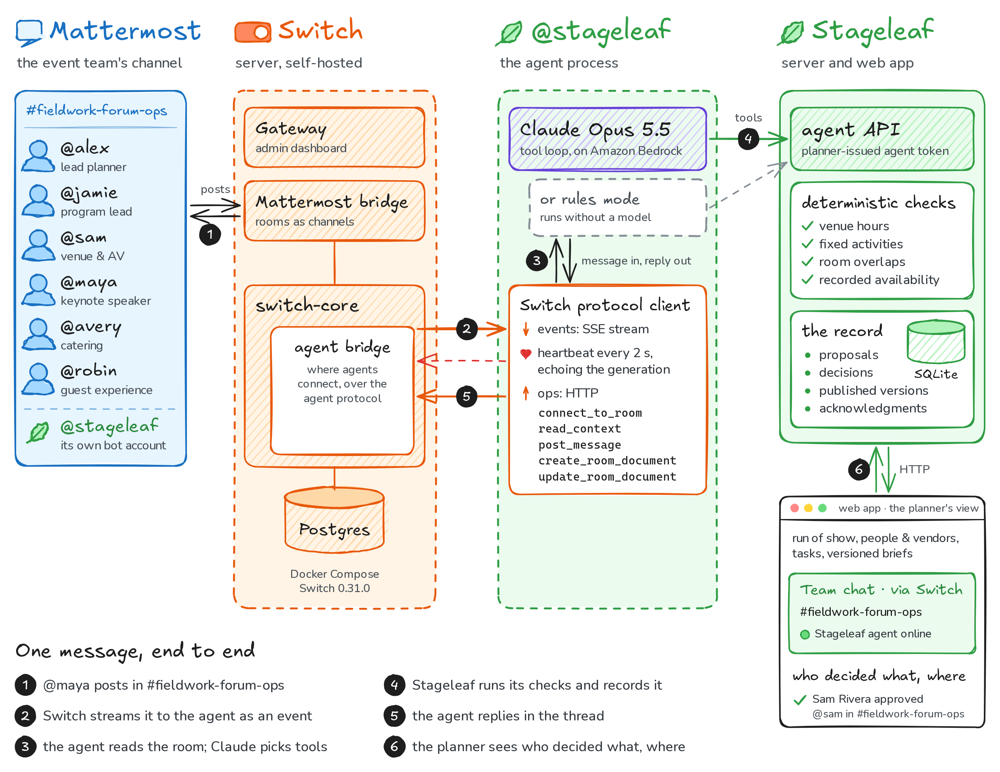

It's event day. At 9 a.m. the keynote speaker messages the team chat: her flight is running late, she'll reach the venue around 11:45, and her slot is 11:15.

One late flight touches the whole day. The AV crew has a mic plan for the keynote. The panel is set for 14:30. Catering is booked for noon, and the printed run of show at the doors is now wrong. In most event teams, this is where the side messages start ("who's telling AV?", "which version is current?"), and by noon someone is still working from the old plan.

For [Flip the Switch](https://www.wemakedevs.org/hackathons/switch) I built **Stageleaf**: an event-operations workspace with an AI agent that sits in the team's chat room through **[Switch](https://github.com/sandbox-quantum/switch)**. This post explains how it works, how I set Switch up from nothing, and what I'd tell anyone connecting their first agent.

**Links:** [code](https://github.com/tpavankalyan/stageleaf) · [demo video](#) · Switch [docs](https://docs.switchagents.ai/)

## What we built

Stageleaf is a normal planner's tool first: events, a run of show, owners and vendors, tasks, and versioned briefs, each person seeing only their own part. The interesting part is what happens when something changes.



Here's the real exchange from the recorded demo, trimmed:

1. **Maya** (the speaker) posts in `#fieldwork-forum-ops`: *"@stageleaf my flight into SFO is running late. I won't get to the venue until about 11:45, so I can't do the 11:15 keynote slot."*
2. **The agent** records her new arrival in Stageleaf. Stageleaf immediately flags the keynote as outside her availability.
3. **The agent tests options** against Stageleaf's deterministic checks.
   - Moving the keynote to 13:00 fails: breakdown would run to 17:30, and Sam's AV crew leaves at 17:00.
   - Swapping the keynote with the builders' panel passes, and nothing else moves.
4. **It proposes the swap in the thread** and @-mentions the three people Stageleaf names as owners: Maya, Sam (AV) and Jamie (program). It asks Jamie the one thing it can't know: can the four panelists do 11:15?
5. **People answer in the thread.** Sam approves. Robin cheerfully approves too, and the agent explains why that doesn't count: nothing Robin owns is changing. Jamie approves and confirms the panelists. Maya approves.
6. **Alex, the lead planner, types "Looks good. Publish it."** Only his chat handle can publish. Stageleaf applies the change and publishes run of show v2. The agent posts a summary to the room, writes the new run of show into a Switch **room document**, and gives each person their own changes.
7. **Sam, Jamie and Maya reply "ack".** Stageleaf records each acknowledgment against v2. Robin and Avery weren't affected, so nobody chases them.

In Stageleaf, the planner sees the same story with provenance: *"Approved @sam in #fieldwork-forum-ops"*, *"Acknowledged @jamie in #fieldwork-forum-ops"*.

## Why Switch, and not another chat bot

Switch's pitch is that each channel becomes a *room* for people and agents, with shared context, and that any agent can join if it speaks the protocol. For this workflow, that maps onto exactly the things I needed:

| What the workflow needs | What Switch provides |
| --- | --- |
| The agent in the place the team already talks | Rooms bridged to Mattermost. The agent has its own bot account in the channel. |
| To know who said something | Every message event carries the sender's handle on the chat platform. |
| One thread per change, without @-ing the bot every time | Thread follow-ups: replies in the agent's thread reach it. |
| Conventions every agent and person can see | Room instructions, shown to every agent that connects. |
| The published plan living in the room | Room documents an agent can create and update. |
| Not being locked to one model or vendor | A plain protocol: SSE down, HTTP up. Bring any agent. |

Remove Switch and the workflow doesn't degrade gracefully. It disappears: there's no room, no reliable "who said this", and no thread to decide in.

## Setting up Switch from scratch, headless

Switch's quickstart uses **Switch Console**, the desktop app, which runs a local server for you. I was building on a cloud VM with no desktop, so I ran the server directly with the official standalone Docker Compose file. If you're doing the same, this section will save you some time.



**1. Pin a version and start the stack.** The Compose file *requires* `SWITCH_VERSION`; it refuses to float to `latest`. Take the version from the container registry (I used `0.31.0`), not from the GitHub releases page, which tracks Console. Profiles add the optional pieces: `collab` adds Mattermost plus a setup container that seeds it, and `gateway` adds the admin dashboard.

```sh
curl -fsSL https://raw.githubusercontent.com/sandbox-quantum/switch/switch-v0.31.0/deploy/local/standalone-docker-compose.yml \
  -o docker-compose.switch.yml
# .env holds SWITCH_VERSION=0.31.0, DB passwords, AGENT_REGISTRATION_TOKEN, SECRET_KEYS, admin + Mattermost credentials
docker compose -f docker-compose.switch.yml --env-file .env --profile collab --profile gateway up -d
curl http://127.0.0.1:8000/health   # the agent bridge
```

In the repo, `npm run switch:up` does all of this and generates the secrets for you.

**2. Turn on the feature I needed.** Thread follow-ups (a reply in the agent's thread reaching it without an @-mention) sit behind a feature flag in 0.31:

```sh
FEATURE_FLAGS_ENABLED=follow_the_conversation
```

Without it, everyone has to write `@stageleaf approve`. With it, they just write `approve`.

**3. Register a custom agent.** The registration token from `.env` registers an agent once and returns its API key, also once:

```js
await fetch("http://127.0.0.1:8000/agents", {
  method: "POST",
  headers: { Authorization: `Bearer ${AGENT_REGISTRATION_TOKEN}`, "Content-Type": "application/json" },
  body: JSON.stringify({
    name: "stageleaf",
    description: "Event operations agent",
    connector_type: "custom",
    integration_profile: {
      connection_model: "always_on",
      message_exchange: true,
      pre_invocation_mediation: [],
      post_invocation_mediation: [],
      event_reporting: [],
    },
  }),
}); // → { id, api_key }
```

**4. Let the team talk to it.** This one cost me a few minutes. A newly registered agent answers **only its owner**: its addressing policy defaults to owner plus owner's agents. An agent can't change its own settings, so the admin clears the policy through the Gateway:

```js
// after POST /gateway/auth/login with the admin credentials (session cookie)
await fetch(`http://127.0.0.1:8000/gateway/agents/${agentId}/addressing-policy`, {
  method: "PUT", headers: { "Content-Type": "application/json", Cookie: cookie },
  body: JSON.stringify({ policy: null }), // null = anyone may address it
});
```

**5. Create the room.** An agent can create rooms through the `create_room` operation. On a Mattermost bridge this provisions the channel, and you can add people by their Mattermost usernames and give the room its instructions in the same call:

```js
await op("create_room", {
  name: "fieldwork-forum-ops",
  description: "Event operations for Fieldwork Forum",
  instructions: "Report a change by mentioning @stageleaf… Only the lead planner publishes a revision…",
  agent_names: ["stageleaf"],
  user_names: ["alex", "jamie", "sam", "avery", "robin", "maya"],
  bridge_id: mattermostBridgeId, // from list_bridges
  channel_type: "channel_public",
});
```

`npm run demo:setup` in the repo does steps 3–5, creates the demo team's accounts, and links the room to a sample Stageleaf event.

## Speaking the agent protocol



Claude Code, Codex and OpenCode can join a room through Switch Console. I wanted a purpose-built agent with its own tools and rules, so I implemented the [agent protocol](https://docs.switchagents.ai/switch-rooms/internals/agent-protocol) directly in about 250 lines of Node (`agent/switch-client.mjs`). It's refreshingly small:

- **Down: one server-sent-event stream.**
  - `GET /agents/{id}/events?connection_id=<uuid>&scope=all&filter=all`. You choose the connection id and reuse it across reconnects.
  - The first frame is `connection_state`. After that come `message` events with `sender_name`, `body`, `message_id`, `thread_id` and an `addressed` flag.
- **Up: HTTP operations.** `POST /agents/{id}/ops/{name}` with an `X-Switch-Connection-Id` header. The ones I use are `connect_to_room`, `read_context`, `post_message`, `create_room_document` and `update_room_document`.
- **A heartbeat every 2 seconds.** `POST /agents/{id}/connection/beat`.

**The gotcha that cost me the most time:** if you declare a protocol revision (`protocol=6`), every heartbeat must echo the connection's `generation` from `connection_state`. Otherwise the server answers `409 unfenced`, the heartbeat lapses after 6 seconds, and you're evicted in a loop. The fix is one field:

```js
// on connection_state
this.generation = data.generation;
// every heartbeatMs
fetch(`${base}/agents/${id}/connection/beat`, {
  method: "POST",
  headers: { Authorization: `Bearer ${apiKey}`, "Content-Type": "application/json" },
  body: JSON.stringify({ connection_id: this.connectionId, generation: this.generation }),
});
```

Two more things worth knowing:

- **`post_message` goes to the room your connection is currently in**, so call `connect_to_room` first. If an agent serves several rooms, process messages one at a time (or keep a connection per room), or a reply can land in the wrong room. `connect_to_room` also returns the room's instructions and participants, which I feed to the model.
- **Resume with `Last-Event-ID`.** I persist the last handled event id and message ids, so a restart catches up on anything said while the agent was down without answering twice.

## Keeping people in charge of the decisions



The thing I cared about most: an approval must come from the person who owns the decision. If the model can type "Sam approved", the whole workflow is theatre.

So **the model chooses actions, never identity**:

- **Evidence comes from Switch, in code.** For every message, the agent's code builds `evidence` from the Switch event itself: room id, message id, and the sender's handle (`sam`). Every tool that acts for a person (`record_decision`, `record_acknowledgment`, `publish_revision`) attaches that evidence automatically. The tool schemas have no "who" field.
- **Stageleaf verifies every action.** The room must be the event's linked room. The handle must map to a contact who owns an affected activity. Only the lead planner's handle can publish.
- **Refusals go back to the model as normal tool errors.** When Robin's "approve" arrived, the model explained the refusal in plain words.

There's a test for exactly this: a scripted "model" tries to record Sam's approval while Robin is the one speaking. Stageleaf refuses, and nothing is recorded.

The same split applies to feasibility. **Deterministic checks decide what works; the model proposes.** Stageleaf knows venue hours, fixed activities, room overlaps and each person's recorded availability. The agent runs candidate plans through `preview_change` before proposing anything.



That's why its proposal message can say *"that pushes Breakdown to 17:30, but Sam's crew leaves at 17:00"*: a check returned that fact. And when something isn't recorded (the panelists' arrival times), the agent asks the person who would know instead of guessing.

## The architecture, end to end



- **Mattermost:** where the team talks. Bundled with the Switch stack, bridged by Switch.
- **Switch server:** switch-core (agent bridge plus MCP), Postgres, the Mattermost bridge and the Gateway. Self-hosted with Docker.
- **The `@stageleaf` agent:**
  - the protocol client;
  - a Claude tool loop (Claude Opus 5.5 on Amazon Bedrock, or the Claude API) that turns messages into tool calls;
  - a rules mode that understands explicit commands, so you can run the whole workflow without any model credentials.
- **Stageleaf:** the system of record. It holds the run of show, the agent API (a planner-issued, revocable token), the checks, decisions, versions and acknowledgments. Its web app shows a *Team chat · via Switch* strip with the room and the agent's live status.

## What I learned

1. **Let the room carry the workflow.** I first imagined approval links and dashboards. The better product put the decision where the conversation already was: one thread per change, answered by the people who own the pieces.
2. **Identity belongs to the platform, not the model.** Switch hands you a trustworthy sender on every event, so use it in code and never let the model restate it.
3. **Read the protocol's control frames.** `connection_state` tells you the heartbeat interval and the generation. Most of my early bugs came from assuming instead of reading it.
4. **Defaults are conservative, which is good.** Owner-only addressing and flag-gated thread follow-ups are sensible server defaults. Just know they exist when your teammates' messages seem to vanish.
5. **Deterministic checks make the model better, not worse.** With `preview_change` available, the agent's proposals got shorter and more confident. It cited facts instead of hedging.

## Try it

```sh
git clone https://github.com/tpavankalyan/stageleaf && cd stageleaf
npm ci && npm run build
npm run switch:up      # Switch + Mattermost + Gateway (Docker)
npm start              # Stageleaf on :4317
npm run demo:setup     # agent, team, room, sample event v1
npm run agent          # Bedrock / Claude API, or rules mode with no credentials
node scripts/rehearse.mjs   # optional: play the scenario
```

Open Mattermost at `http://localhost:8065`, sign in as `alex` (passwords are in `switch/credentials.json`), and tag `@stageleaf` in `#fieldwork-forum-ops`.

Built for Flip the Switch 2026 (Best Business Workflow). Switch is © SandboxAQ, Apache 2.0 with the Commons Clause. Stageleaf is MIT.
